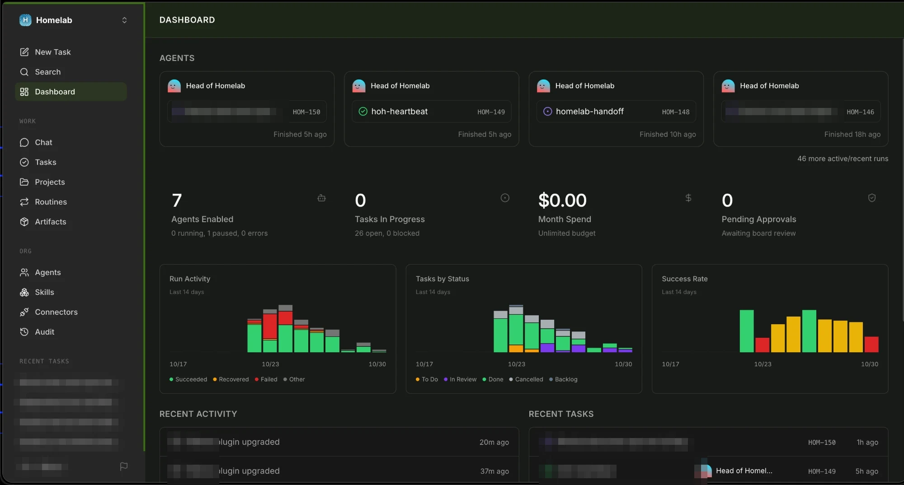
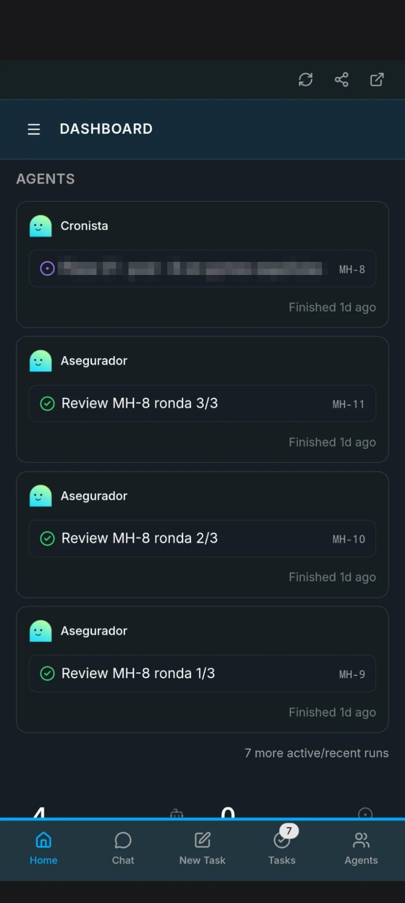
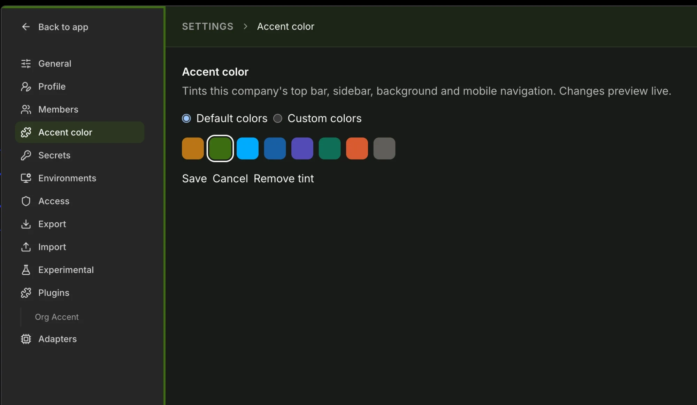
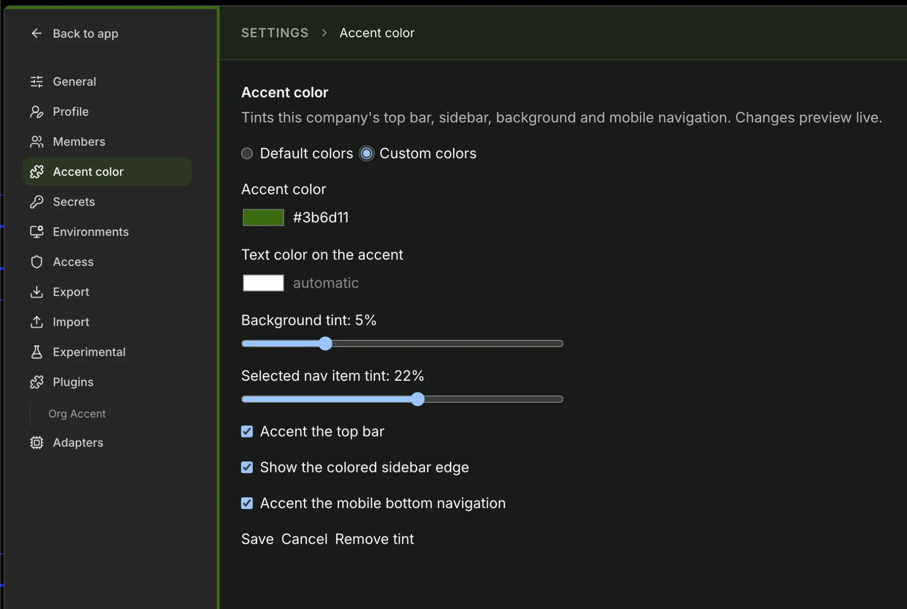

<p align="center">
  
</p>

<p align="center">
  <a href="#-install"><strong>Install</strong></a> &middot;
  <a href="#-how-to-use-it"><strong>How to use it</strong></a> &middot;
  <a href="https://www.npmjs.com/package/paperclip-plugin-org-accent"><strong>npm</strong></a> &middot;
  <a href="https://github.com/paperclipai/paperclip"><strong>Paperclip</strong></a>
</p>

<p align="center">
  <a href="https://www.npmjs.com/package/paperclip-plugin-org-accent"></a>
  <a href="LICENSE"></a>
  <a href="https://github.com/paperclipai/paperclip"></a>
  
</p>

<br/>

# 🎨 Org Accent: one color per company in Paperclip

**Know which company you're in before you read a single word.**

> I built this plugin because I was tired of opening tasks in the wrong
> organization. It happened mostly on my phone, or when I was in a hurry. With
> this small change my mind links each organization to a color, and it doesn't
> happen anymore. I'd love to hear your feedback!

A [Paperclip](https://github.com/paperclipai/paperclip) plugin that gives each
company its own accent color, much like a per-workspace color in a code
editor. Pick a swatch, and the sidebar, header, background and mobile
navigation take that color for that company only.

<p align="center">
  
  
  
  
  
  
  
  
</p>

<br/>

## Org Accent is right for you if

- ✅ You run **several companies** in one Paperclip instance
- ✅ You've **created a task in the wrong company** at least once
- ✅ You manage Paperclip **from your phone** and the labels are tiny
- ✅ You want the color **without Paperclip's layout moving a single pixel**

<br/>

## Features

<table>
<tr>
<td align="center" width="33%">
<h3>🖍️ One-click presets</h3>
Eight tuned colors with readable text. Click a swatch, see it live, save.
</td>
<td align="center" width="33%">
<h3>🎛️ Custom colors</h3>
Any hex color, your own text color, tint sliders and a toggle for each accent.
</td>
<td align="center" width="33%">
<h3>📱 Mobile too</h3>
The bottom navigation gets a colored line, a tint and an accented active item.
</td>
</tr>
<tr>
<td align="center">
<h3>🌗 Light and dark</h3>
Tints are mixed into Paperclip's own surfaces, so both themes stay readable.
</td>
<td align="center">
<h3>📐 Zero layout shift</h3>
Lines are inset shadows and tints are backgrounds. Nothing moves.
</td>
<td align="center">
<h3>🔒 Safe by design</h3>
Every value is validated on both sides, so stored settings can't inject CSS.
</td>
</tr>
</table>

<p align="center">
  
</p>

<br/>

## 📦 Install

Org Accent needs Paperclip 2026.1012.0 or later, which has the
`appShellOverlay` and `companySettingsPage` plugin slots.

**From npm** (recommended):

```bash
paperclipai plugin install paperclip-plugin-org-accent
```

**From source:**

```bash
git clone https://github.com/TrasteCC/paperclip-plugin-org-accent.git
cd paperclip-plugin-org-accent
pnpm install
pnpm build
paperclipai plugin install /path/to/paperclip-plugin-org-accent
```

The installable package is `package.json` plus `dist/`; `node_modules/` is not
needed at runtime. The plugin asks for four capabilities:
`ui.action.register`, `instance.settings.register`, `plugin.state.read` and
`plugin.state.write`.

## 🚀 How to use it

1. Switch to the company you want to color.
2. Open Settings and click Accent color in the left menu. The same page is
   also under Plugins > Org Accent.
3. Click one of the eight swatches. The whole interface takes the color right
   away, so you can try a few.
4. Click Save. Cancel, or leaving the page, puts the previous color back.

Repeat for each company. Only board users can change the color.



If none of the presets suits you, choose Custom colors. You can then type any
color, set how strong the tints are and turn each accent on or off.



A company with nothing saved opens on Default colors. Remove tint brings a
company back to stock Paperclip.

### 🖍️ Default colors

Eight swatches, one click each. The sliders and toggles stay hidden and every
option uses its default.

| Preset | Accent | Text on accent |
|---|---|---|
| Amber | `#BA7517` | `#FFFFFF` |
| Green | `#3B6D11` | `#FFFFFF` |
| Sky | `#00AAFF` | `#04263A` |
| Blue | `#185FA5` | `#FFFFFF` |
| Violet | `#534AB7` | `#FFFFFF` |
| Teal | `#0F6E56` | `#FFFFFF` |
| Coral | `#D85A30` | `#FFFFFF` |
| Slate | `#5F5E5A` | `#FFFFFF` |

The plugin saves the preset's name, not its colors, so if a later release
retunes a preset, every company using it picks up the change.

### 🎛️ Custom colors

| Option | Values | Default |
|---|---|---|
| Accent color | `#rgb` or `#rrggbb`; empty means no tint | empty |
| Text color on the accent | hex; empty picks white or near-black, whichever reads better | automatic |
| Background tint | 0 to 20 % | 5 % |
| Selected nav item tint | 0 to 40 % | 22 % |
| Accent the top bar (sidebar top line and header tint) | on or off | on |
| Sidebar edge | on or off | on |
| Accent the mobile bottom navigation | on or off | on |

A tint of 0 % leaves Paperclip's own background or highlight alone. Switching
from Default to Custom starts you from the colors of the preset you had.

## 🗄️ Stored settings

Each company has one record in the plugin's state store (`ctx.state`, scope
`company`, key `accent`):

```json
{
  "mode": "default",
  "preset": "blue",
  "accentColor": null,
  "textColor": null,
  "backgroundTint": 5,
  "navTint": 22,
  "showBand": true,
  "showSidebarEdge": true,
  "showMobileNav": true
}
```

Custom values survive a switch to Default mode, so switching back restores
them. `showBand` is a name left over from v0.2, when the plugin drew a band
with the company name; it now controls the top bar accent. Older records still
load: one without `mode` opens as Custom, and missing fields take their
defaults.

The settings page and the worker both validate every field. `mode` must be
`default` or `custom`, `preset` must be one of the eight names, colors must be
hex, percentages are rounded and clamped to their range, and toggles must be
booleans. A stored value therefore cannot inject CSS. Agents cannot change the
settings.

To set a color without the UI, call the worker action `save-accent` with
`companyId` and any of the fields above:

```json
{ "companyId": "<company-id>", "mode": "default", "preset": "teal" }
```

## ⚙️ How it works

The plugin fills three slots:

- `appShellOverlay` (`AccentOverlay`). Paperclip mounts it once per selected
  company and disposes it when you switch. It reads the company's settings,
  writes one `<style id="paperclip-org-accent-style">` into `<head>` and sets
  `data-org-accent` on `<html>`. On unmount it removes both. It renders nothing
  visible.
- `companySettingsPage` (route `accent-color`) and `settingsPage`, both showing
  `AccentSettingsPage`. The live preview rewrites the same style element.

### Selectors

The SDK has no theming API, so the plugin styles Paperclip's page directly.
The selectors come from Paperclip 2026.1012.0 (commit
`bba6a45f0d364cfd962ac59b3bdf2426a8222adb`). They match on structure and ARIA
attributes rather than class names, so they also fit upstream
`8035f8b245fddeda5857a2248688eaac7c6051e6`, which adds the classes
`.paperclip-app-shell`, `.app-main-row` and `.app-breadcrumb`. The tests run
them against both versions, each with the default (`Layout.production.tsx`) and
the streamlined (`Layout.tsx`) shell.

| Selector or variable | What it styles | Upstream source |
|---|---|---|
| `div:has(> a[href="#main-content"])` (shell) | The app shell root, the only element whose direct child is the "Skip to Main Content" link. It holds `--org-accent`, `--org-accent-text` and the tinted `--background`. | `ui/src/components/Layout.production.tsx`, `ui/src/components/Layout.tsx` |
| `--background`, light base `oklch(1 0 0)` | The page surface, mixed with the background tint. | `ui/src/index.css` `:root` |
| `.dark` shell `--background`, dark base `oklch(0.205 0 0)` | The dark-mode surface. The `dark` class sits on `<html>`. | `ui/src/index.css` `.dark`, `ui/src/context/ThemeContext.tsx` |
| shell ` div:first-child:not(:has(aside)):has(+ div main#main-content)` (top bar) | The header that wraps the breadcrumb: the first child of the content column, right before the row that holds `<main>`. The sidebar column also precedes that row, so anything containing an `<aside>` is excluded. Gets a 10 % accent background. | `ui/src/components/Layout.production.tsx`, `ui/src/components/Layout.tsx`, `ui/src/components/BreadcrumbBar*.tsx` |
| shell ` aside:has(> nav)` | The primary sidebar. Gets `inset 0 3px 0` along the top and `inset -3px 0 0` on the right edge, each behind its own toggle. The plugin overlay's `<aside>` has no `<nav>` and is not matched. | `ui/src/components/Sidebar.production.tsx`, `ui/src/components/Sidebar.tsx` |
| sidebar ` nav a.bg-accent`, ` nav a.bg-sidebar-accent`, ` nav a[aria-current="page"]` | The selected item: the default shell's class, the streamlined shell's class and the router's ARIA attribute. | `ui/src/components/SidebarNavItem.production.tsx`, `ui/src/components/SidebarNavItem.tsx` |
| `nav[aria-label="Mobile navigation"]` | The bottom bar shown below the `md` breakpoint. Gets `inset 0 3px 0` along the top and a 12 % accent mixed into `--muted`. | `ui/src/components/MobileBottomNav.tsx` |
| `nav[aria-label="Mobile navigation"] a[aria-current="page"]` | The active bottom bar item, drawn in the accent color. | `ui/src/components/MobileBottomNav.tsx` |

The rules sit outside any CSS layer, so they beat Tailwind v4's
`@layer utilities` classes without `!important`. Popovers and dialogs render
outside the shell and keep the stock theme.

## 🛠️ Building from source

The toolchain matches Paperclip's plugin scaffold
(`packages/plugins/create-paperclip-plugin`): esbuild with the SDK's
`createPluginBundlerPresets`, Vitest and TypeScript. `@paperclipai/plugin-sdk`
and `@paperclipai/shared` are pinned to `2026.1012.0`; change the pin to match
the Paperclip you run.

```bash
pnpm install
pnpm typecheck
pnpm test
pnpm build
```

## ⚠️ Known limits

- The light and dark base surface colors are copied from upstream `index.css`.
  If Paperclip changes `--background`, update the two values in `src/accent.ts`.
- In the streamlined UI the sidebar paints its own surface, so its background
  may stay untinted while the lines and the selected item still change. On the
  streamlined task view the breadcrumb moves next to `<main>`, where the header
  tint does not reach.
- The New Task entry in the mobile bar is a button rather than a link, so it
  never shows as active.
- Only the selected company is tinted. The company switcher, popovers and
  dialogs keep Paperclip's colors.

## 📄 License

MIT
